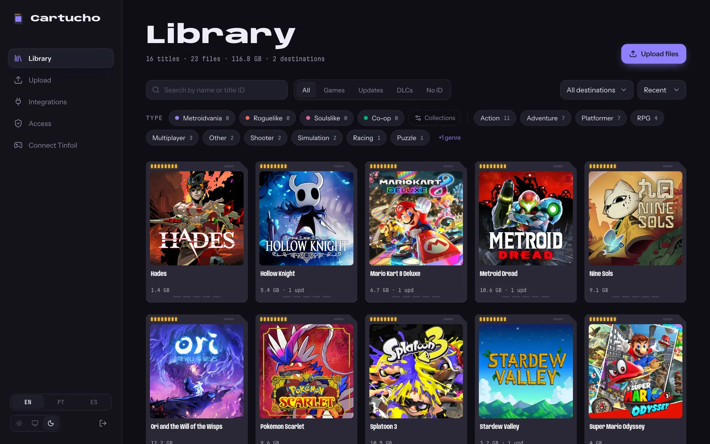
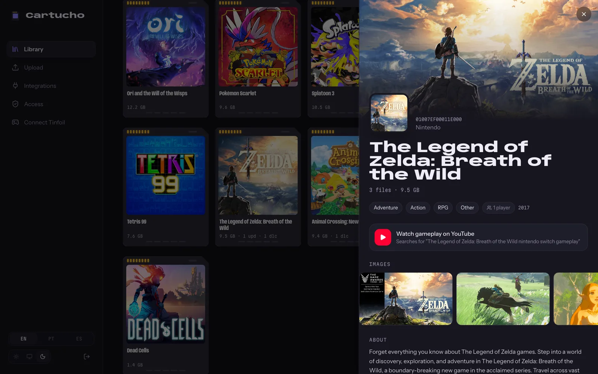
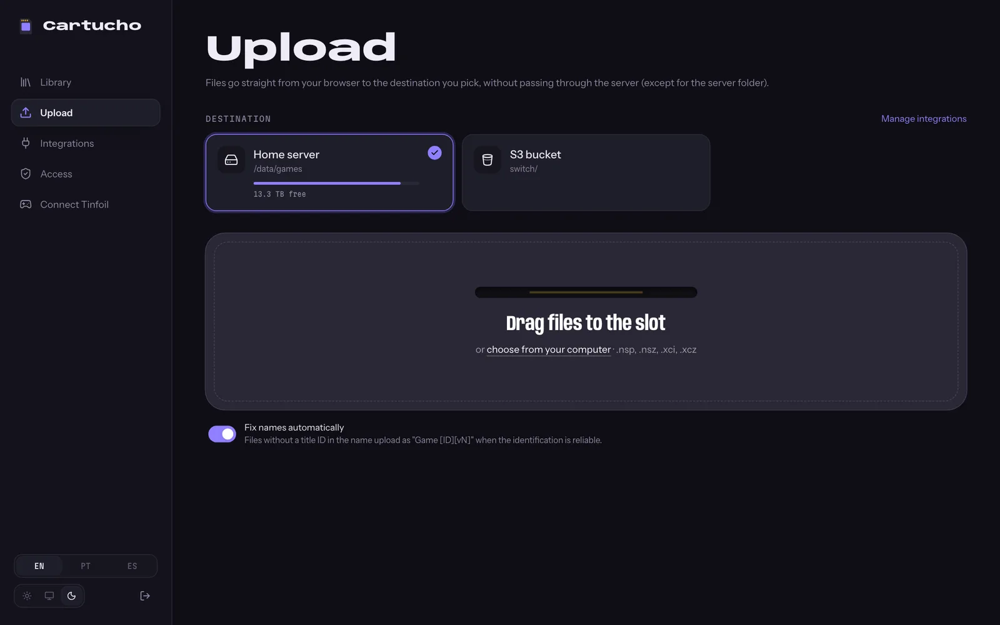
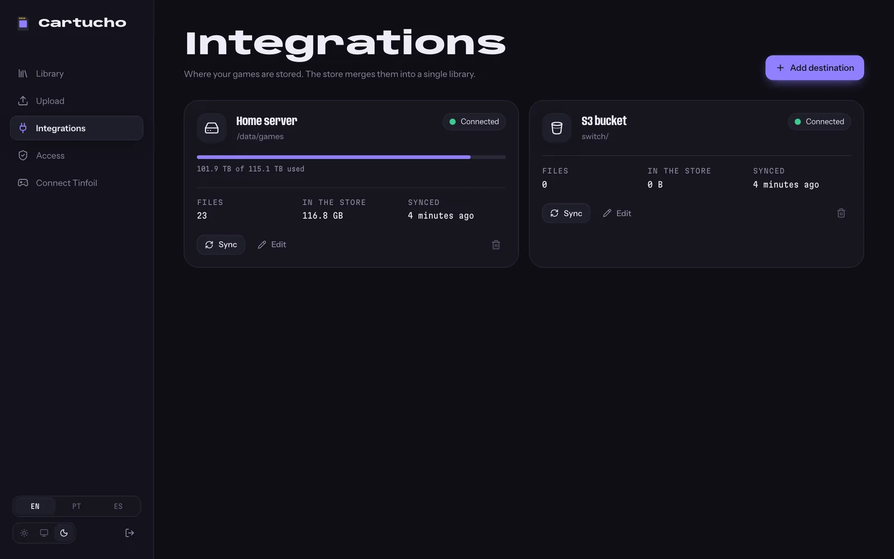
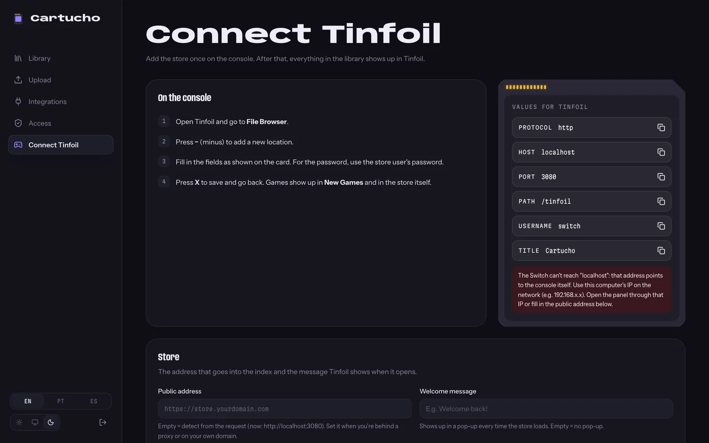

# Cartucho

A private [Tinfoil](https://tinfoil.io) store for your own Nintendo Switch backups, with a web panel to run it.

Your files stay where you want them: **Google Drive**, any **S3-compatible bucket** (AWS S3, Cloudflare R2,
Backblaze B2, MinIO) or a **folder on the server**. Cartucho merges them into one library, shows it with
covers and metadata, and serves it to Tinfoil as a single store.



> Cartucho is meant for backups of games you own. It doesn't ship, find or share any game content.

## Features

**Library**
- Cover art, names, genres, descriptions, screenshots and player counts from [titledb](https://github.com/blawar/titledb).
- Base game, updates and DLCs grouped into one card; filters by type, genre and your own collections
  (e.g. Metroidvania, Roguelike), which can fill themselves from keywords in the game description.
- Right-click menu on every game and file: download, copy to another destination, move, collections, delete.

**Uploads**
- Files go straight from the browser to the destination: resumable sessions on Google Drive, multipart on S3,
  chunks for the server folder. Pause, resume, automatic retries, speed and time left.
- Files without a title ID in their name are identified before upload (from the NSP/NSZ header, or by a
  fuzzy match against titledb) and uploaded as `Name [TitleID][vN].nsp`.

**Storage**
- Several destinations at once. Move files between them, or **replicate** a file to keep a backup copy:
  if one destination fails, the store serves the copy.
- An identification screen to find and rename files that are missing their title ID, with undo.

**Tinfoil store**
- Index with an embedded `titledb` section, so Tinfoil shows names even without its own database.
- HTTP Basic auth for the index, signed and expiring links for downloads and images (Tinfoil doesn't send
  credentials for those), byte ranges for resumable installs.
- Console approval by Tinfoil UID, and per-IP throttling of wrong passwords.

**Accounts**
- Two roles. **Admin** uploads files, connects destinations, removes games and manages the other accounts.
  **Read-only** browses the library and downloads, and changes nothing.
- One credential per person: the same username and password sign in to the panel and, when that person turns
  **Tinfoil access** on for their own account, to the store from the console.

**Panel**
- English, Portuguese (Brazil) and Spanish; light and dark themes; works on phones.

## Screenshots

| | |
|---|---|
|  |  |
|  |  |

## Quick start (local)

Requirements: Docker.

```bash
docker compose up -d --build              # panel on http://localhost:3080
docker compose --profile s3 up -d --build # same, plus a MinIO bucket to try the S3 destination
```

1. Open the panel and create the admin account (username and password).
2. **Integrations** → add a destination. `./games` is mounted at `/data/games`, ready for "Server folder".
3. **Connect Tinfoil** → turn **Tinfoil access** on for your account, then copy the values into Tinfoil
   (File Browser → press `−` → new location). The password is the one you sign in with.
   The console needs your computer's network address (e.g. `192.168.1.20`), not `localhost`.
4. For other people: **Access** → create an account, pick **Read-only** or **Admin**, and hand over the
   generated password. Each person turns their own Tinfoil access on.

Local MinIO for testing: endpoint `http://minio:9000`, public endpoint `http://localhost:9000`, bucket
`switch`, user `cartucho`, password `cartucho-secret`, path-style on.

Start over with `docker compose down -v && rm -rf games/*`.

## Deploy (Dokploy)

The workflow in `.github/workflows/docker.yml` publishes the image to GitHub Container Registry:

| Tag | When |
|---|---|
| `ghcr.io/5ucr4m/tinfoil-store:latest` | every push to `main` |
| `ghcr.io/5ucr4m/tinfoil-store:sha-xxxxxxx` | every build (pin or roll back) |
| `ghcr.io/5ucr4m/tinfoil-store:1.2.3` | tag `v1.2.3` |

1. Create a **Docker Compose** application from this repository using `docker-compose.prod.yml`.
2. Environment:

   | Variable | Required | Description |
   |---|---|---|
   | `PUBLIC_URL` | no | Fixed public address, e.g. `https://store.example.com`. Empty (recommended when Tinfoil uses the LAN IP): links follow the address each request used, so the console gets LAN links and the panel opened through a domain or tunnel gets an https OAuth redirect. |
   | `APP_SECRET` | yes | Encrypts integration tokens and signs sessions and links. Generate with `openssl rand -hex 32` and keep it stable. |
   | `GAMES_PATH` | no | Host folder for the "Server folder" destination (writable by UID 1000). Defaults to the `cartucho-games` volume. |
   | `CARTUCHO_TAG` | no | Image tag to run instead of `latest`. |

3. **Domains** → add your domain with HTTPS, service `app`, port `3000`.
4. Redeploy to update, or enable Dokploy's deploy webhook.

For Google Drive, create an OAuth client of type *Web application* in Google Cloud with the redirect URI
`https://<your-domain>/api/integrations/gdrive/callback`, and publish the consent screen (in testing mode
Google revokes the token every 7 days). The panel walks you through it.

## How the store works

| Route | Purpose |
|---|---|
| `GET /tinfoil` | Tinfoil index (Basic auth, records the console UID) |
| `GET /tinfoil/gdrive` | Same index with Drive files as `gdrive:` links (experimental direct mode) |
| `GET /tinfoil/d/<token>/<id>/<name>` | File download with byte ranges: proxied, or a redirect to a signed bucket URL |
| `GET /tinfoil/i/<token>/<titleId>/<kind>` | Cover art, resized and cached by the server |

## Development

```bash
bun install
bun run --filter @cartucho/server dev                            # API on :3000
API_URL=http://localhost:3000 bun run --filter @cartucho/web dev # panel on :5173
bun run typecheck
cd apps/web && bun run i18n:check                                # translation checks
```

- `apps/server`: Hono, better-sqlite3, AWS SDK, sharp. Bundled into one file by `build.mjs` (esbuild);
  only the native modules stay in `node_modules`.
- `apps/web`: React, Vite, Tailwind CSS v4, TanStack Query, Motion.
- Bun is the package manager; Node 22 is the runtime. The image is `node:22-alpine` (~78 MB compressed).

### Translations

English is the source; Portuguese and Spanish are typed against it. Add keys to
`apps/web/src/i18n/locales/en/<area>.ts` first, then to `pt-BR` and `es`, and run `bun run i18n:check`.
Server messages live in `apps/server/src/i18n.ts`. See `CLAUDE.md` for the full rules.

### Commits

[Conventional Commits](https://www.conventionalcommits.org) in English, e.g.
`feat(web): add language switch to the sidebar`.
